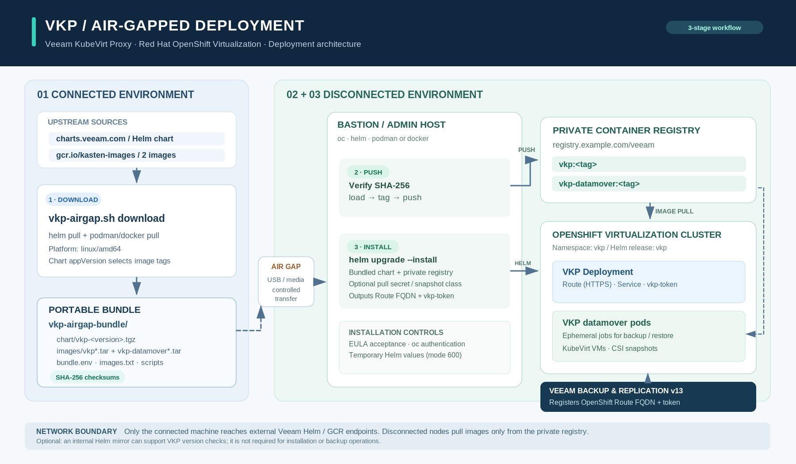

# vkp-airgap

Install the **Veeam KubeVirt Proxy (VKP)** on an air-gapped Red Hat OpenShift Virtualization cluster, with its container images served from a private registry.

VKP is the pod that Veeam Backup & Replication v13 uses to back up and restore OpenShift Virtualization (KubeVirt) virtual machines. Each protected cluster needs one VKP. The official procedure, [Installing Veeam KubeVirt Proxy](https://helpcenter.veeam.com/docs/vbr/userguide/vkp_install_proxy.html?ver=13), installs it straight from `https://charts.veeam.com` and pulls its images from `gcr.io/kasten-images`. An air-gapped cluster can reach neither, so this project splits the procedure into three steps. The chart and images are fetched on a connected machine and moved across the air gap, then the images are pushed to the private registry and VKP is installed pointing at that registry.

## What it does

- `vkp-airgap.sh` runs the download, push and install steps described in the methodology below. Run one step at a time with `download`, `push` or `install`, or run all three with `all`.
- `vkp-airgap-uninstall.sh` removes everything `vkp-airgap.sh` installed. It follows [Uninstalling Veeam KubeVirt Proxy](https://helpcenter.veeam.com/docs/vbr/userguide/vkp_uninstall_proxy.html?ver=13) and adds some cleanup.

## Methodology



### Which images, which tag

The `vkp` chart references exactly two images, both under `image.registry`:

| Image | Used by | Default reference |
|-------|---------|-------------------|
| `vkp` | the VKP daemon (Deployment `vkp`) | `gcr.io/kasten-images/vkp:<appVersion>` |
| `vkp-datamover` | the short-lived pods VKP starts for each backup or restore | `gcr.io/kasten-images/vkp-datamover:<appVersion>` |

The tag is `image.tag`, or the chart's `appVersion` when it is left empty. The images are only published for `linux/amd64`, so the script pulls that platform explicitly. Without it, pulling from an ARM machine such as an Apple Silicon Mac would fail.

### Step 1, download (connected machine)

1. Adds the `veeamrepo` Helm repository (`https://charts.veeam.com/`) and pulls the `vkp` chart as a `.tgz`, either the latest version or the version you choose.
2. Reads the chart's `appVersion`, so the images are always pulled with the tag that matches the chart.
3. Pulls `vkp` and `vkp-datamover` for `linux/amd64` and saves each one as a `docker-archive` tar file.
4. Writes `bundle.env` (chart file, versions, image list), `images.txt` and a `SHA256SUMS` file covering the chart and the image archives.
5. Copies `vkp-airgap.sh` and `vkp-airgap-uninstall.sh` into the bundle, because the air-gapped side cannot fetch them from GitHub.

Bundle layout:

```
vkp-airgap-bundle/
  bundle.env                 # CHART_FILE, CHART_VERSION, APP_VERSION, IMAGES, ...
  images.txt                 # source image references
  SHA256SUMS                 # integrity of the chart and the image archives
  chart/vkp-<version>.tgz
  images/vkp_<appVersion>.tar
  images/vkp-datamover_<appVersion>.tar
  vkp-airgap.sh
  vkp-airgap-uninstall.sh
```

A bundle for chart 1.0.3 is about 300 MB.

### Transfer

Copy the whole `vkp-airgap-bundle` directory across the air gap, using whatever your security policy allows. The next two steps check `SHA256SUMS` before doing anything and stop if a file was altered or corrupted on the way.

### Step 2, push (machine that can reach the private registry)

1. Verifies the bundle checksums.
2. Optionally logs in to the registry (`podman login` or `docker login`).
3. For each image: `load` from the tar file, `tag` from `gcr.io/kasten-images/<image>:<appVersion>` to `<private-registry>/<image>:<tag>`, then `push`.

The target tag defaults to the chart's `appVersion`, and you can choose another one, for example `1.0.3-airgap`. The pushed manifest digest is the same as the upstream `linux/amd64` manifest, so image signatures and scan results stay valid.

### Step 3, install (machine with `oc` access to the cluster)

This maps to the official procedure as follows:

| Veeam procedure | What the script does |
|-----------------|----------------------|
| 1. OpenShift CLI 4.20+ and Helm 4.1+ | Checks both and warns if they are older |
| 2. `oc login` | Reuses the current session, otherwise prompts for the API address and user and runs `oc login` |
| 3. `helm repo add` / `helm repo update` | Not needed, the chart comes from the bundle |
| 4. `helm install vkp ... --set eula.accept=true` with the air-gapped parameters | Shows the EULA and asks you to accept it, then runs `helm upgrade --install` from the bundled chart with `image.registry`, `image.tag`, `chartRepo` (optional) and the pull secret (optional) |
| 5. Snapshot class annotation (only with several VolumeSnapshotClasses) | Lists the StorageClasses and VolumeSnapshotClasses and offers either annotation |
| 6. Retrieve the FQDN and token | Prints the Route host and the `vkp-token` value to enter in Veeam Backup & Replication |

Other details of this step:

- Helm values are written to a private temporary file (mode 600, deleted on exit) instead of being passed with `--set`. This keeps registry credentials out of the process list and shell history.
- When the registry requires authentication, the chart's `secrets.dockerConfig` creates the `vkp-ecr` pull secret used by the VKP deployment. The script also runs `oc secrets link vkp vkp-ecr --for=pull` so that the datamover pods, which run under the `vkp` service account, can pull their image too.
- `chartRepo` is the Helm repository VKP checks for newer versions, which it reports to Veeam Backup & Replication. If you mirror `charts.veeam.com` internally (Nexus, Artifactory, ChartMuseum...), give its URL. Otherwise the default is kept and the version check simply fails without affecting backups.
- The install uses `helm upgrade --install --wait`, so running it again with a newer bundle upgrades VKP in place.

## Prerequisites

Connected machine (download):
- `helm`
- `podman` or `docker`
- Access to `charts.veeam.com` and `gcr.io`

Disconnected machine (push, install):
- `oc` 4.20 or later and `helm` 4.1 or later, as required by Veeam
- `podman` or `docker` for the push step
- `jq` and `base64` for the install step
- `sha256sum` or `shasum`
- Network access to the private registry and to the cluster API
- An OpenShift account with cluster-admin permissions, because the chart creates a ClusterRole, a ClusterRoleBinding and a SecurityContextConstraints

Cluster:
- Red Hat OpenShift with OpenShift Virtualization installed
- Nodes able to pull from the private registry. If the registry uses a certificate signed by a private CA, add it to the cluster's trusted CAs first:

```bash
# Use registry.example.com..5000 as the key when the registry listens on a port
oc create configmap registry-ca -n openshift-config \
  --from-file=registry.example.com=/path/to/ca.crt
oc patch image.config.openshift.io/cluster --type=merge \
  -p '{"spec":{"additionalTrustedCA":{"name":"registry-ca"}}}'
```

The machine running the push step must also trust that CA (for Docker, `/etc/docker/certs.d/<registry>/ca.crt`, for Podman, `/etc/containers/certs.d/<registry>/ca.crt`).

## Deployment

Get the scripts on the connected machine:

```bash
git clone https://github.com/cpouthier/vkp-airgap.git
cd vkp-airgap
```

### Air-gapped deployment, three machines or more

```bash
# Connected machine
./vkp-airgap.sh download

# ... transfer vkp-airgap-bundle/ across the air gap ...

# Machine that reaches the private registry
cd vkp-airgap-bundle
./vkp-airgap.sh push

# Machine that reaches the cluster (often the same bastion)
./vkp-airgap.sh install
```

### Single bastion that reaches the internet, the registry and the cluster

```bash
./vkp-airgap.sh all
```

Running the script without an argument shows a menu of the four modes.

### Non-interactive use

Every prompt is skipped when the matching variable is already exported:

| Variable | Step | Meaning | Default |
|----------|------|---------|---------|
| `BUNDLE_DIR` | all | Bundle directory | `./vkp-airgap-bundle` |
| `CHART_VERSION` | download | VKP chart version | latest |
| `CONTAINER_TOOL` | download, push | `podman` or `docker` | podman if installed, else docker |
| `TARGET_REGISTRY` | push, install | Private registry path, e.g. `registry.example.com/veeam` | none |
| `TARGET_TAG` | push, install | Image tag in the private registry | chart `appVersion` |
| `REGISTRY_LOGIN` | push | `y` to log in before pushing | `N` |
| `VKP_NAMESPACE` | install | Namespace for VKP | `vkp` |
| `OC_SERVER`, `OC_USER` | install | Used only when not logged in yet | none |
| `EULA_ACCEPT` | install | `y` to accept the Veeam License Agreement | `N` |
| `EULA_COMPANY`, `EULA_EMAIL` | install | Recorded with the EULA acceptance | empty |
| `CHART_REPO_URL` | install | Internal mirror of `charts.veeam.com` | `https://charts.veeam.com` |
| `PULL_AUTH` | install | `y` when pulling from the registry needs credentials | `N` |
| `REGISTRY_USER`, `REGISTRY_PASSWORD` | install | Pull credentials, stored only in the `vkp-ecr` Secret | none |
| `SNAPSHOT_MODE` | install | `1` skip, `2` per StorageClass, `3` one class for all | `1` |
| `SNAPSHOT_STORAGE_CLASS`, `SNAPSHOT_CLASS` | install | Used with `SNAPSHOT_MODE` 2 or 3 | none |

Example:

```bash
export BUNDLE_DIR=/data/vkp-airgap-bundle TARGET_REGISTRY=registry.example.com/veeam
./vkp-airgap.sh push
EULA_ACCEPT=y ./vkp-airgap.sh install
```

Never put registry passwords in a file committed to Git. Let the script prompt for them, or export them from a secret manager in the current shell only.

## User guide

### 1. Download

```
$ ./vkp-airgap.sh download
 Output directory for the bundle (default: ./vkp-airgap-bundle):
 VKP Helm chart version to download (leave empty for latest):
Downloaded chart: ./vkp-airgap-bundle/chart/vkp-1.0.3.tgz
VKP chart version: 1.0.3, image tag (appVersion): 1.0.3
==> Pulling gcr.io/kasten-images/vkp:1.0.3 (linux/amd64)
==> Pulling gcr.io/kasten-images/vkp-datamover:1.0.3 (linux/amd64)
Bundle ready in ./vkp-airgap-bundle
```

### 2. Push

```
$ ./vkp-airgap.sh push
==> Verifying bundle checksums
chart/vkp-1.0.3.tgz: OK
images/vkp-datamover_1.0.3.tar: OK
images/vkp_1.0.3.tar: OK
 Private registry path to push the images to, e.g. registry.example.com/veeam:
 Tag to give the images in the private registry (default: 1.0.3):
Images available in the private registry:
  registry.example.com/veeam/vkp:1.0.3
  registry.example.com/veeam/vkp-datamover:1.0.3
```

### 3. Install

The script shows the EULA, asks you to accept it, asks for the remaining settings, installs VKP and waits for it to be ready. If the cluster has several VolumeSnapshotClasses, it then asks which one VKP should use:

- per StorageClass: `oc annotate storageclass <sc> vkp.veeam.com/volume-snapshot-class=<vsc>`
- for every snapshot: `oc annotate volumesnapshotclass <vsc> vkp.veeam.com/is-snapshot-class=true`

At the end it prints the connection details:

```
==> VKP connection details for Veeam Backup & Replication
FQDN:  vkp-vkp.apps.cluster.example.com
Token (keep it private):
eyJhbGciOi...
```

### 4. Add the cluster to Veeam Backup & Replication

In the Veeam Backup & Replication console, add a Red Hat OpenShift Virtualization server using that FQDN and token, see [Adding Red Hat OpenShift Virtualization Server to Backup Infrastructure](https://helpcenter.veeam.com/docs/vbr/userguide/vkp_add_server.html?ver=13). Veeam Backup & Replication must be able to reach the OpenShift router on port 443.

### Checking the installation

```bash
oc get pods,route,pvc -n vkp
oc get deployment vkp -n vkp -o jsonpath='{.spec.template.spec.containers[0].image}{"\n"}'
oc get deployment vkp -n vkp -o jsonpath='{.spec.template.spec.containers[0].env[?(@.name=="DATA_MOVER_IMAGE")].value}{"\n"}'
```

Both images must point at the private registry.

## Alternatives on OpenShift

- **Cluster-wide pull secret.** Instead of the per-namespace `vkp-ecr` secret, you can add the registry credentials to the global pull secret, then answer `N` to the authentication question:

  ```bash
  oc get secret/pull-secret -n openshift-config \
    --template='{{index .data ".dockerconfigjson" | base64decode}}' > pull-secret.json
  oc registry login --registry=registry.example.com --auth-basic='<user>:<password>' --to=pull-secret.json
  oc set data secret/pull-secret -n openshift-config --from-file=.dockerconfigjson=pull-secret.json
  rm pull-secret.json
  ```

- **ImageTagMirrorSet.** If your disconnected cluster already redirects `gcr.io/kasten-images` to the private registry with an `ImageTagMirrorSet`, the images can keep their original references. This project sets `image.registry` explicitly instead, because that is the method the Veeam documentation describes and it does not depend on the node-level mirror configuration.

## Uninstall

```bash
./vkp-airgap-uninstall.sh
```

Remove the Red Hat OpenShift Virtualization server from Veeam Backup & Replication first, as Veeam recommends. The script then:

1. Runs `helm uninstall vkp -n <namespace>`.
2. Deletes any cluster-scoped objects left over from an interrupted install (`ClusterRole`, `ClusterRoleBinding` and `SecurityContextConstraints` named `vkp-<namespace>`).
3. Runs `oc delete namespace <namespace>`.
4. Lists the `vkp.veeam.com/*` snapshot class annotations and removes them if you confirm.
5. Optionally removes the local VKP images and the bundle directory.

Images pushed to the private registry are left in place. Delete them with your registry's own tooling if needed.

## Troubleshooting

| Symptom | Likely cause |
|---------|--------------|
| `ErrImagePull` / `ImagePullBackOff` on `vkp` | Wrong `TARGET_REGISTRY` or `TARGET_TAG`, or missing pull credentials. Check `oc describe pod -n vkp` |
| `x509: certificate signed by unknown authority` while pulling | The registry CA is not in `image.config.openshift.io/cluster` `additionalTrustedCA` |
| Datamover pods stuck in `ImagePullBackOff` during a backup | The `vkp` service account does not carry the pull secret: `oc secrets link vkp vkp-ecr --for=pull -n vkp` |
| `EULA not accepted` from Helm | Answer `y` to the EULA question, or export `EULA_ACCEPT=y` |
| `checksum mismatch` | The bundle was altered or truncated during the transfer, copy it again |
| `exec format error` | An image for a non-amd64 platform was mirrored. Run the download step again with this script, which pins `linux/amd64` |

## Changelog

### 1.0.0

- First version: `download`, `push`, `install` and `all` modes for VKP chart 1.0.x on OpenShift, Docker and Podman support, SHA256 bundle verification, optional pull secret linked to the `vkp` service account, snapshot class annotation, and `vkp-airgap-uninstall.sh`.
